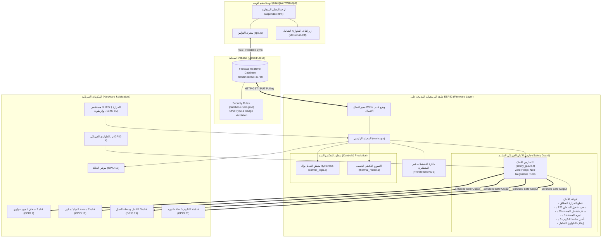

# معمارية النظام المتكامل (System Architecture)
## SmartCare Multi-Socket IoT Hub

منظومة موزع المقابس الذكية المتكاملة مبنية على مبدأ **«الأمان أولاً (Safety-First Architecture)»** مع استقلالية تامة للحافة (Offline-First Autonomy) وإدارة متعددة القنوات للأحمال الكهربائية المنزلية.

---

## 1. مخطط المعمارية الشامل (Architecture Diagram)

---

## 2. مصفوفة وظائف القنوات الأربعة (Channel Specifications)

| القناة | نوع الحمل الكهربائي | دبوس GPIO | القواعد الإلزامية لحارس الأمان | السلوك عند انقطاع الإنترنت |
|---|---|---|---|---|
| **قناة 1 (Thermal)** | سخان حراري / مبرد | GPIO 2 | - قطع فوري عند $\ge 45$°م. - سقف تشغيل مستمر 120 دقيقة. - إغلاق فوري عند عطل المستشعر. | يستمر بالتحكم التلقائي الذاتي عبر قراءات DHT22 المحلية. |
| **قناة 2 (Water Pump)** | ماتور مياه حثي | GPIO 18 | - سقف تشغيل مستمر 20 دقيقة منعاً للاحتراق وفيضان الخزان. - فترة سكون إجبارية 5 دقائق قبل إعادة التشغيل. | يحتفظ بآخر حالة آمنة ويقفل تلقائياً عند استنفاد المؤقت. |
| **قناة 3 (Appliance)** | تلفاز / شاشات / أجهزة ترفيهية | GPIO 19 | - إيقاف تلقائي بعد 4 ساعات للقضاء على هدر الاستعداد (Vampire Drain). | يظل خاضعاً للمؤقت الداخلي المحلي. |
| **قناة 4 (AC / Inductive)** | مكيف هواء / ضاغط | GPIO 21 | - تأخير إلزامي للضاغط 180 ثانية (Anti-Short-Cycle) لمنع القفل الميكانيكي. - نطاق Hysteresis $\pm 0.5$°م. | يستمر بالتبريد الذاتي ضمن النطاق المحفوظ في NVS. |

---

## 3. مبدأ عزل طبقة الأمان (Safety Decoupling)
تم تصميم كود `safety_guard.c` بلغة ANSI C الصرفة دون استخدام:
- أي دوال حجز ديناميكي للذاكرة (`malloc` / `free`).
- أي مكتبات شبكية أو بروتوكولات سحابية.
- أي مؤشرات غير مفحوصة (NULL-checked bounds).
هذا يضمن أن قرار الأمان مستقل تماماً عن نجاح أو فشل طبقة الاتصال بالشبكة.
